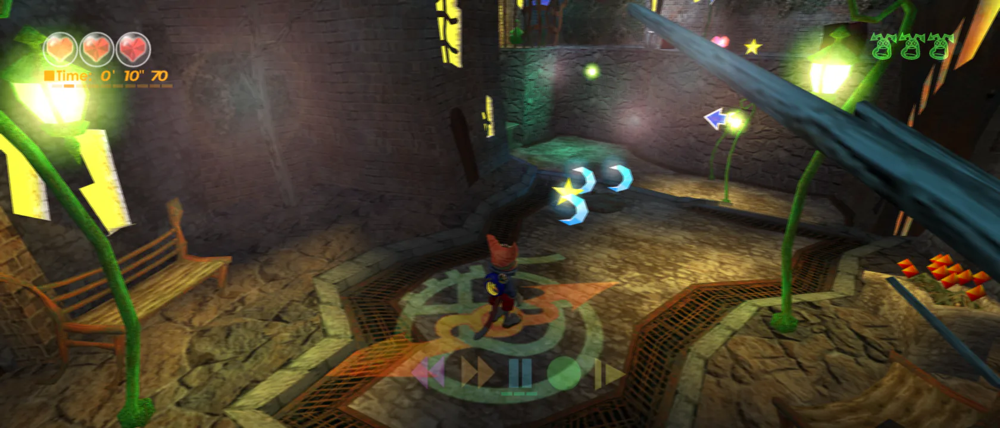
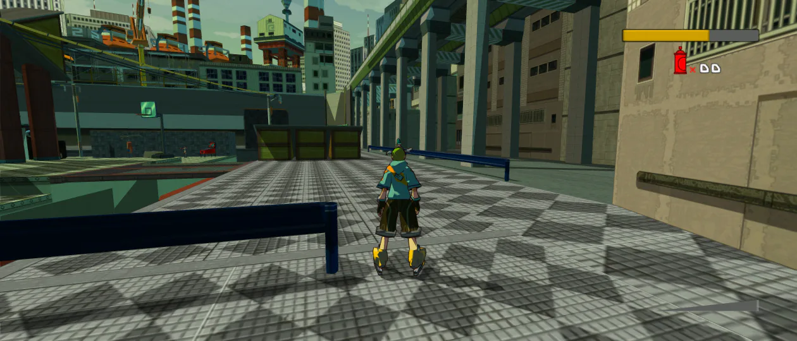
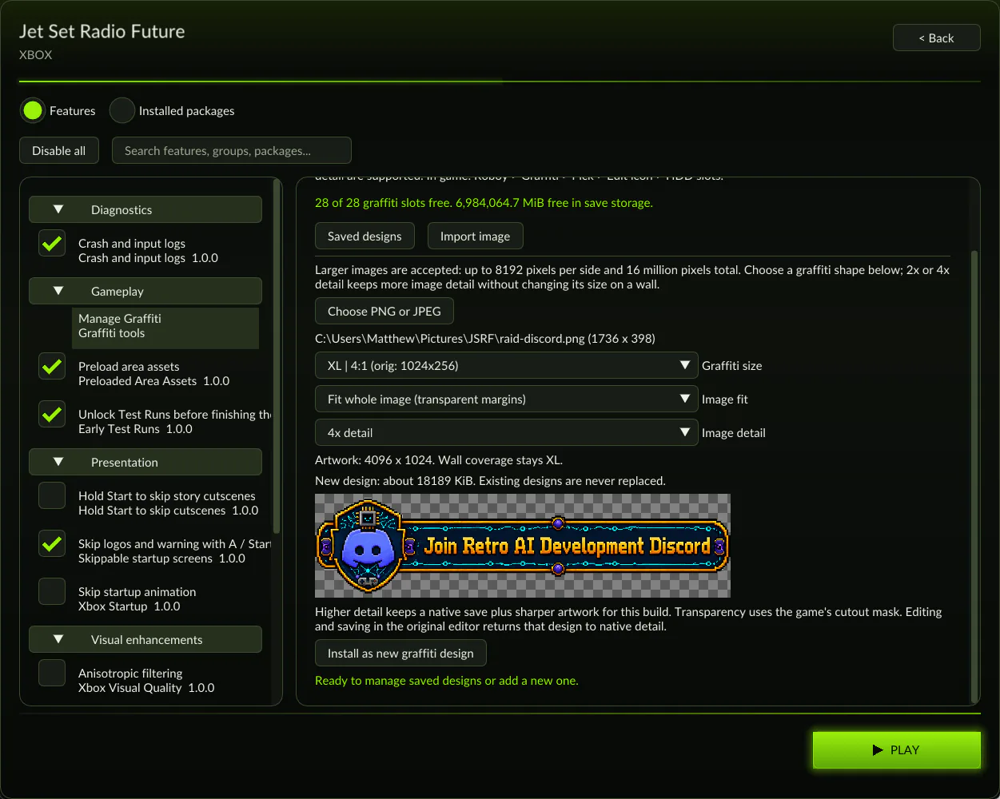

I am pleased to announce the release of my original Xbox Low Level Recompiler, or Xbox LLR for short.

I've chosen to change up my branding a little bit and instead of just calling it XboxRecomp, I pivoted. As I move into increasingly newer systems, I've begun to notice that most other recompiler engines are focusing on HLE only. The underlying OS isn't there. This is something I found great success with, particularly in psxrecomp, which led to titles being able to be "one shot". I've taken a few different design approaches in the *how* I implemented this compared to my previous , which I'll discuss later in the article.

## What it can do

Xbox LLR follows my standard approach to recompilers, which is that it should be able to run it faithfully compared to original hardware. That means you can boot up the original Xbox menu just the same and navigate it as if it was on an original Xbox.

The codebase is split into interchangeable sub systems. The first is LLE. This is entirely faithful, but it isn't performant. The second part is **host native friendly HLE.**

To do my best de-buzzwording, I have Low Level Emulation functions that are *faithful*, and then *high level emulation* functions that replace and combine multiple LLE functions into a singular HLE system, with a contract that the HLE system should take the same entry point as the entry point LLE subsystem and provide the same output as the output LLE subsystem.

Put simply: HLE and LLE should take the same input and give the same output. What happens in between doesn't have to match. Being able to combine and skip things is what gives us performance when porting. The "host native" part just means it chooses operations that should be faster and more performant on say, your Windows or Linux PC.

As is expected of a recompiler project, this translates code ahead of time instead of just in time (interpreted). At present, unlike most of my other projects, XboxLLR does **not** currently contain a fallback interpreter for missed instructions.

### How I did this one differently

Most of my earlier implementations have been ground up, using faithful reference emulators as an oracle basis and a lot of QA testing on the first few titles. The recompilation ecosystem has exploded since I started this type of work last year, and people are cropping up everywhere making recompilers for their favorite games. A number of them are either forks or disjointed one offs, typically HLE focused, to make their *one* game work. That means it either misses a lot of Xbox's other functionality since it isn't exercised in that one game, or it omits a lot because it's HLE and that subsytem may be missing contractual bits that would make it less agnostic and support a wider base of Xbox titles.

However, there's a lot of good still to be found in those. With permission, I was able to check out a number of these existing recomp projects and borrow and adapt their HLE implementations and tricks and adhere to my LLE:HLE contract.

> **Note:** A special thank you to sp00nz for [xboxrecomp](https://github.com/sp00nznet/xboxrecomp), Phobos for [DirectXbox-Recomp](https://github.com/phobos665/DirectXbox-Recomp), NoRain for [doaxvb-re](https://github.com/NoRain211/doaxvb-re), and the [xemu](https://github.com/xemu-project/xemu) team for their reference implementations.

## What it can play

I chose to focus on two titles that had a lot of personal meaning to me:

### [Blinx the Time Sweeper](https://github.com/mstan/BlinxRecomp)

Blinx was one of my first titles for the Xbox. I enjoyed it a lot (despite the end game being difficult). Even having to use the Duke controller, I managed to power through into the late game with my pre-teen hands. I always looked forward to the game getting a sort of remaster some day and had never considered that I might be the one to do so.

**Enhancements**

Blinx has a particularly unforgiving endgame. I wasn't able to actually beat it when I was younger and only did so many years later as an adult. The resource management in the end game is unforgiving, and that 10 minute timer can be daunting, even for an adult in the later stages. To relieve that, and to demonstrate the modding capacity, I've added the following optional enhancements for Blinx:

- **Remove 10 minute timer limit**
- **Time Crystals**
  - Increase the number of holdable crystals OR
  - Have infinite crystals and all non-heart time crystals on the map do not spawn

### [Jet Set Radio Future](https://github.com/mstan/jsrfrecomp)

The other one was a must-have for me, and one I felt even more strongly about: Jet Set Radio Future. The game has such a fun environment and gameplay. It's easy to pick up and super fun. I feel the game has been trapped on the Xbox for far too long, with so-so emulation and no real re-releases, and it was an aspiration of mine to see this one get a second life as well.

**Enhancements**

For Jet Set Radio future, the two game specific enhancements I sought for this were:

- **Challenges**
  - Challenges no longer require the game to be beaten. All other requirements still apply. This allows you to 100% an area and unlock more secret characters *before* the game has been beaten, which adds value to unlocking them in the first place
- **Import your own sprays into the game as PNGs**
  - This one was a no brainer for me. I am not an artist, and the in-game editor for JSRF was awful. The original Xbox didn't permit you to write files to disk anyway, so you never really *could* import your own art. For such an awesome feature; it was locked behind the technology of its time, and is finally able to be liberated in the modern era.

> **Note:** The sprays are imported to your Xbox's's saves as JSRF grafitti can be chosen in game. This attempts to take advantage of Xbox LLR's low level emulation.

### Shared Game Status

Both games are in beta, meaning they haven't been tested end to end. Playtesting has gone for a couple of hours through both across a handful of playtesters, which some agentic testing skipping through to the later parts of the games. It is by no means exhaustive, but should be a playable experience.

Both games also have shared visual enhancements. Adaptive Fit to screen, tested up to 21:9 (with 32:9 expected to be supported) is available. The HUD should adjust as the resolution is changed.

Early experiments in supersampling, internal resolution increases, etc, are available, but still may not be performant on all machines. Refinement by both myself and the community will help further these along.

## Xbox Dashboard

Faithful to the name and intent of XboxLLR, the third "title" that XboxLLR runs is the dashboard itself. Demonstrating the commitment to being extensive, below is the original Xbox dashboard, itself recompiled.

At present, the dashboard's capacities are very limited. Most services do not work, a number of menu functions are unimplemented. Enough was stood up to prove the basic experience. It cannot run any arbitrary XBEs yet, but I am hopeful that as the community needs it, we'll be able to work together to add more support.

## What's available now?

### xboxllr

For those interested in starting their own Xbox game using XboxLLR, check out the repo [here](https://github.com/mstan/xboxllr). XboxLLR is still early yet, but aims to follow the philosophies set forth in my other recompilers, and should give it a strong foundation towards standing up future titles.

### Blinx The Time Sweeper

Players interested in testing out Blinx's beta can check out its repo [here](https://github.com/mstan/BlinxRecomp). The game is *expected* to be playable end to end, but I am actively seeking playtesters to confirm. Please use Github issues to file any bug reports!

> **Note:** Blinx ships with widescreen and mods to allow unlimited time crystals and a removed 10 minute timer to allow for easier play in late game

### Jet Set Radio Future

Players interested in testing out JSRF can check out *its* repo [here](https://github.com/mstan/jsrfrecomp). JSRF has not been as exhaustively playtested and crashes may occur for unimplemented functinoality. Players are encouraged to save often and enable diagnostic logs to provide in Github issues in order to allow for quicker issue reproduction.

> **Note:** JSRF ships with widescreen and mods to allow challenge campaigns to be completed without beating the game. It also features the importing of your own custom graffiti to really personalize your game experience

## What comes next?

### Further Optimizations

The earliest goal is to aim to continue to improve reliability and efficiency of XboxLLR. This will include exploring optimizations to allow for use on lower end devices as well as visual enhancements without slowdown.

### Online Play

Online play is another target. As Xbox LLR is low level focused, it should be more compatible with private online XBLA services.

In addition, for games that never feature online play, exploration of implementing [recomp-net](https://github.com/TechnicallyComputers/recomp-net), the netplay engine behind [psxrecomp](https://github.com/RetroPortingToolKit/psxrecomp/tree/master), [snesrecomp](https://github.com/RetroPortingToolKit/snesrecomp) and more will be explored.

## Closing

XboxLLR is my first step into this generation of consoles. Over the past year, I started on many earlier consoles to learn more about how to approach this process with AI. I have learned many lesson along the way, and continue to do so.

XboxLLR's introduction is a pivotal point. When I began this work, I felt in many ways I was part of an early trend that was showing the world that this can be done. Today, it's evident that many people are paying attention based on the wealth of resources and other projects out there. For XboxLLR, the initiative felt more like a unification of separated community projects instead of entering the scene as a stepping stone.

I'm very excited to see what the community has done thus far and what will continue to be done. I am hopeful that xboxLLR can be a rallying point to help drive that initiative further.

---

*Originally published on [1379.tech](https://1379.tech/xboxllr-beta-blinx-jet-set-radio-future/).*
