From the beginning, my goal on my recompilers has been accuracy under an LLE (low level emulation) focus. The intent here being that LLE is an uncompromising way to ensure correctness. From there, I would focus on using drop-in HLE (high level emulation) for my ecosystems.

I wanted to hold off on "premature optimization" until I really had a foundation that these things were on point. My inflection point became when I was able to have speedrunners going through my titles performing speedrun glitches and techs, that I had a solid baseline to reference.

So I took time to pivot, and go through all of my ecosystems. The intent was to be able to have performance focused HLE to replace the *correct*, but slow LLE ecosystems. One HLE system was permitted to replace multiple LLE subsystems, but it had to adhere to the input and output contract of the respective system(s) it was replacing. A game's output should be behaviorally the same.

I was able to pull some great outcomes from this work. The 16 bit era was where most of the gains were had, but I was able to save time across all of them.

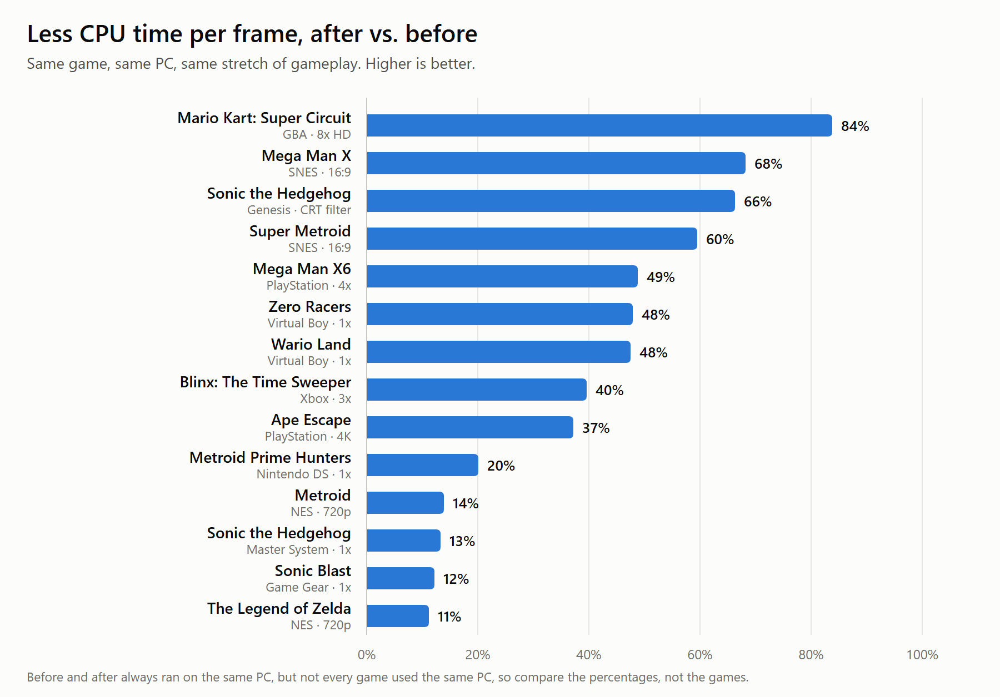

*Each comparison is two builds of the same game on the same PC, playing the same stretch of gameplay back to back. Most games are locked to their original speed, so the win shows up as headroom for higher resolutions and weaker hardware.*

## What the headroom buys: upscaling

The clearest way to see it is in the 3D games, where a higher internal resolution adds real detail.

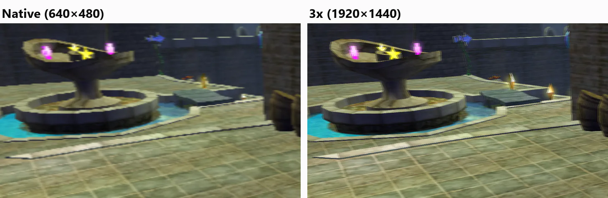

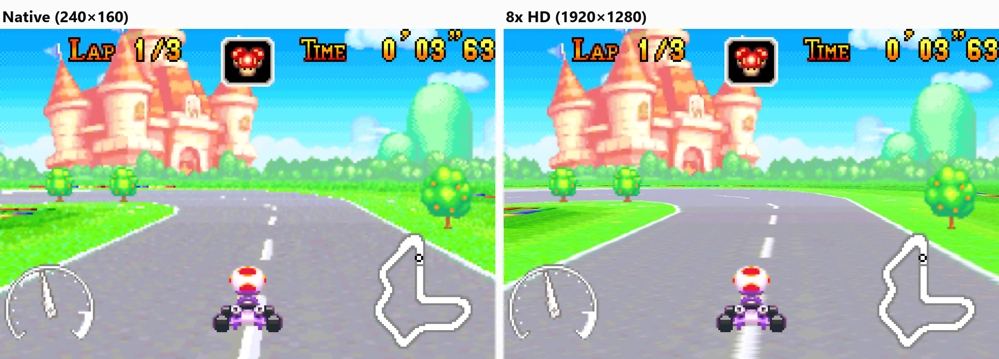

## System by system

### PlayStation

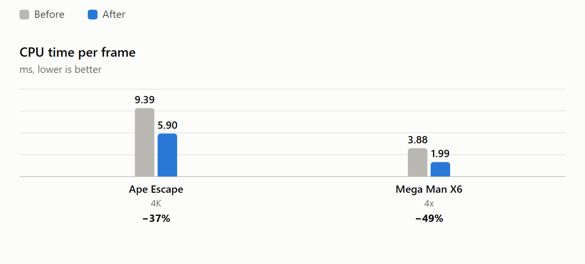

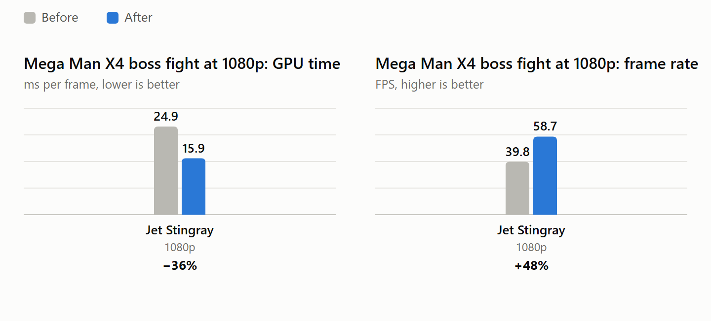

### SNES

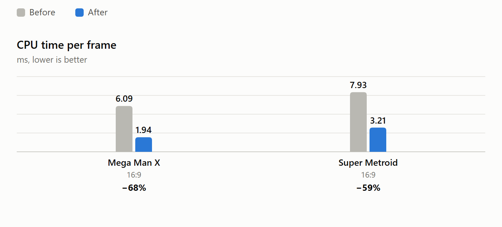

### Game Boy Advance

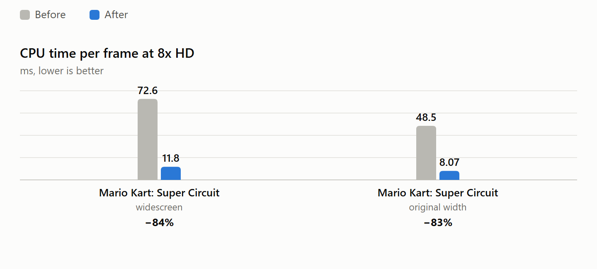

### Virtual Boy

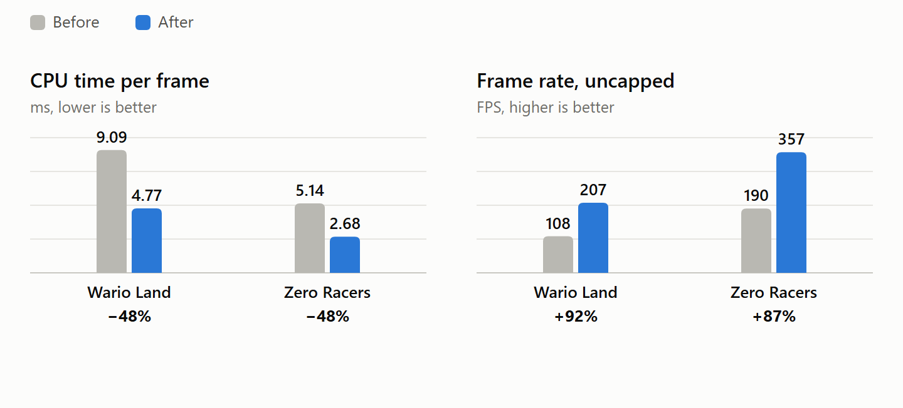

### Sega Genesis

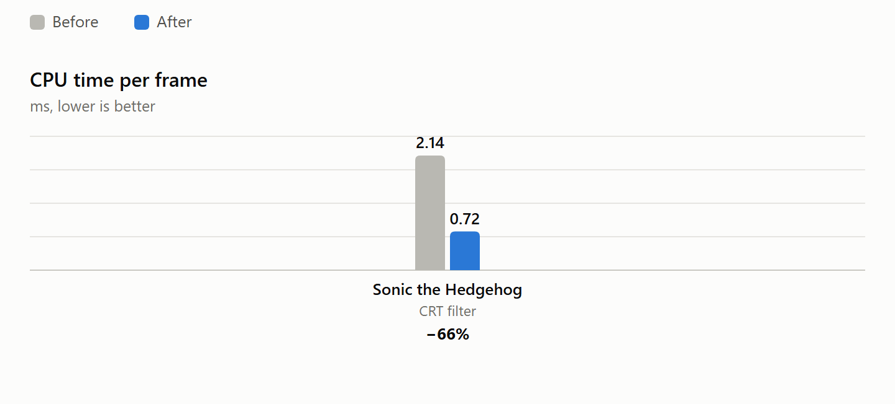

### Original Xbox

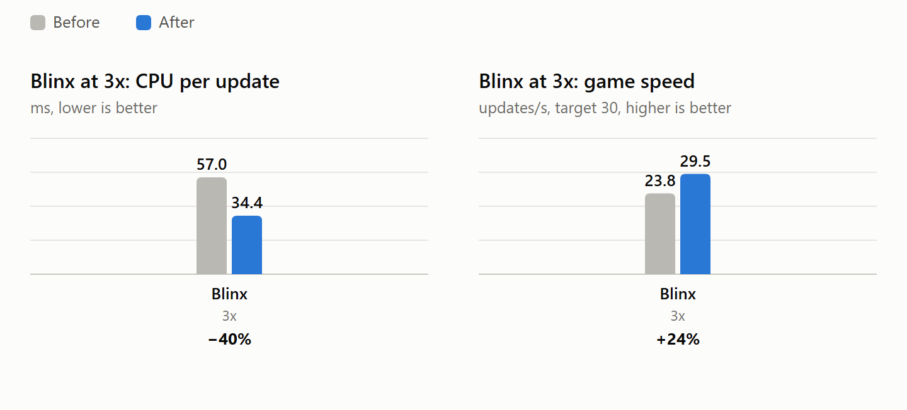

### Nintendo DS

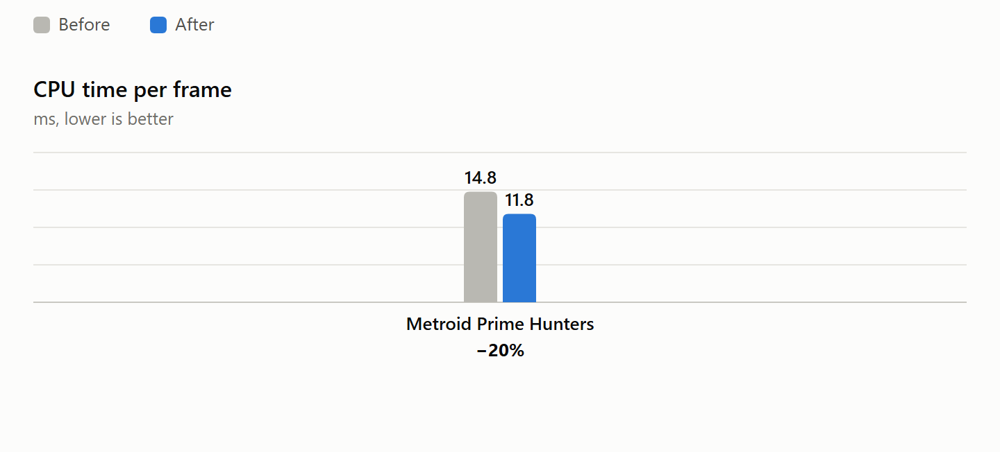

### NES, Master System and Game Gear

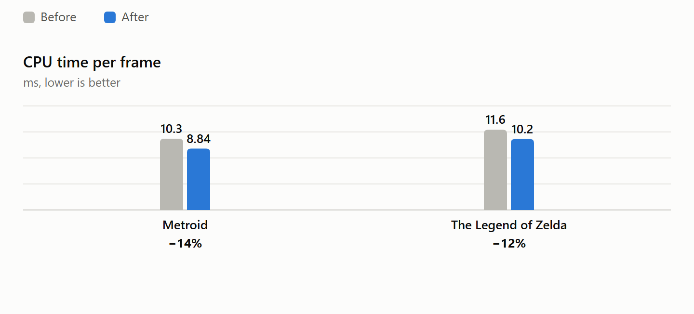

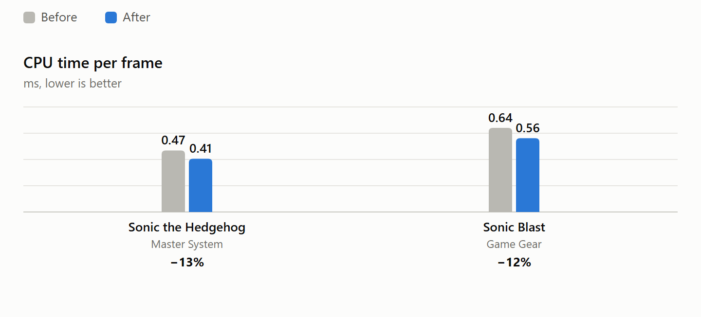

The 8-bit systems gained less, and that's expected. Their hardware is simple: a slow 8-bit CPU, a basic tile-and-sprite video chip and a few sound channels. Reproducing it was never the expensive part, so there was less waste to remove. Sonic on the Master System already took under half a millisecond per frame, about 3% of its frame budget.

## Not everything worked

Every idea was built and measured, and kept only if it won. On PlayStation alone, 10 changes shipped and 12 were thrown out. One native geometry engine made Ape Escape 22% slower. On Genesis, about a dozen ideas, including new FM synth kernels, were measured and reverted.

## Building on one of these? Update.

If you've been using one of my frameworks, I heavily encourage you update. This should vastly improve your ability to enhance, as well as your end user's experience on low end hardware.

Know something using one of these for their project? Ask them to update!

- **NES:** [nesrecomp](https://github.com/mstan/nesrecomp)
- **Master System / Game Gear:** [smsggrecomp](https://github.com/mstan/smsggrecomp)
- **SNES:** [snesrecomp](https://github.com/RetroPortingToolKit/snesrecomp)
- **Sega Genesis / Sega CD:** [segagenesisrecomp](https://github.com/mstan/segagenesisrecomp)
- **Virtual Boy:** [vbrecomp](https://github.com/mstan/vbrecomp)
- **Game Boy Advance:** [gbarecomp](https://github.com/mstan/gbarecomp)
- **Nintendo DS:** [ndsrecomp](https://github.com/RetroPortingToolKit/ndsrecomp)
- **PlayStation:** [psxrecomp](https://github.com/RetroPortingToolKit/psxrecomp)
- **Original Xbox:** [XboxLLR](https://github.com/mstan/xboxllr)

---

*Originally published on [1379.tech](https://1379.tech/recompiler-performance-host-native-hle/).*
