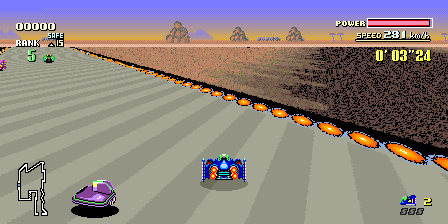
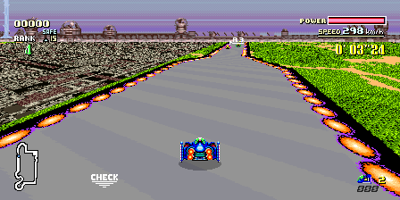
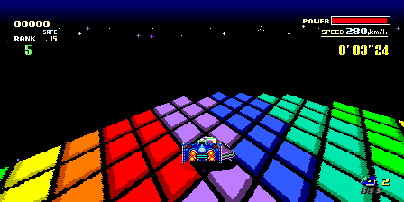
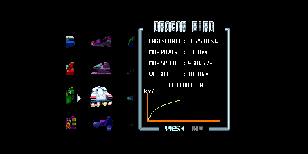
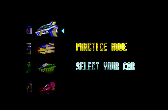
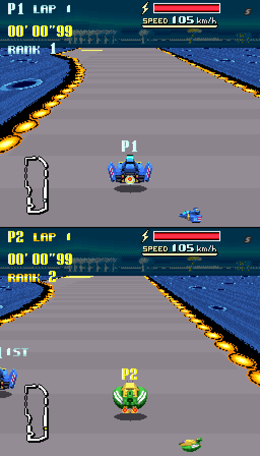
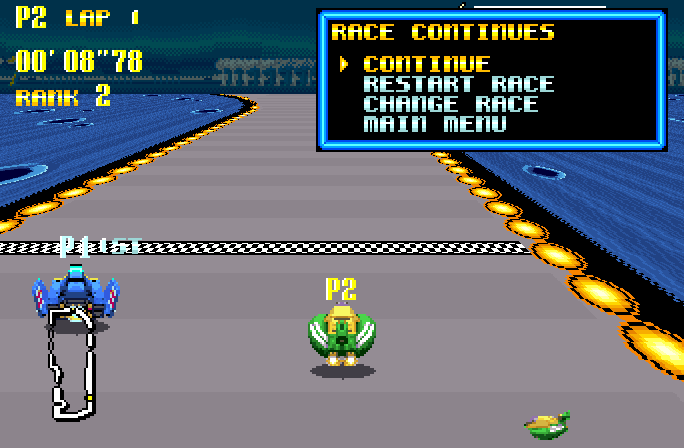
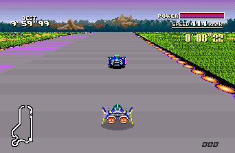
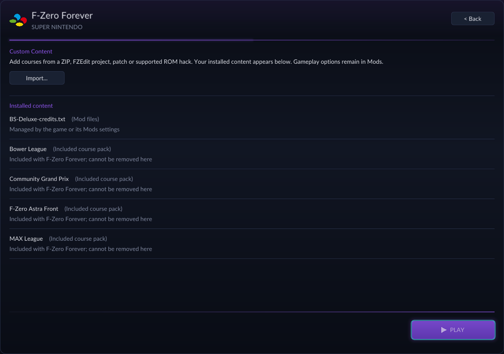
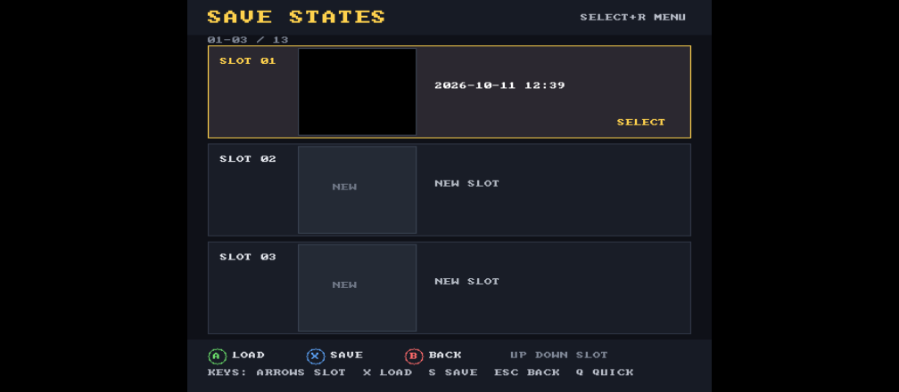

[F-Zero Forever](https://github.com/RetroPortingToolKit/F-ZeroForever) is a modern PC conversion of the original SNES anti-gravity racer.

When people think about recompilations, the cliche is one non-technical person asking Claude to make me a port. They barely know the game, and it falls apart the minute you run into a bug. Our ambition for F-Zero Forever was to push it to new heights, with overwhelming amounts of modes and content, and all the technical improvements we could throw at it.

The same week we started our efforts, a really ambitious romhack called the [F-Zero Community Grand Prix](https://romhackplaza.org/romhacks/f-zero-community-grand-prix-cgp-super-nintendo-romhack) was released. The devs had put so much care in creating not just new races and cars, but new obstacle types and functionality. It was a deep mod of the game. I reached out to them on their Discord and explained what our team at [RetroPortingToolkit](https://github.com/RetroPortingToolKit), led by GameMaster, had in mind.

There was some resistance. Some of the CGP co-creators did not love the AI use. It helped that I'm a huge anti-gravity racing fan, particularly of F-Zero GX and the original SNES game. After hours of hashing it out with the team, we agreed on the vision for F-Zero Forever. This game is the result of 7 weeks of work, by 5 contributors: GameMaster led all the technical implementation, Shokunin (me) for the design / features, and Worthy MF9, Fennor and MatoLabu did possibly over a hundred hours of QA. It's very probably the largest team effort in a recomp, ever.

This project is a great example of what AI can achieve in the hands of a dedicated team that cares. We would never have had the time or resources to put this many features together otherwise, and we pushed the game further than anyone has in its 35 years. That took developers willing to put in the hours, and it took hardcore fans of the game testing it, fixing it, and coming up with improvements. It only worked because we combined the two.

## 75 races. 15 cups.

We worked with the community and combined several of the highest quality ROM hacks for the game, including **[Community Grand Prix](https://romhackplaza.org/romhacks/f-zero-community-grand-prix-cgp-super-nintendo-romhack), Astra Velocity, Bower, and MAX**. You can even [bring your own ROM hacks and create your own races](#bring-your-own-races-or-make-them). This is the largest combination of tracks EVER for F-Zero.

> All bundled ROM hack content is included with explicit permission from its authors and creators. AI was not used in any way to modify the ROM hacks or their content. The inclusion of their work in this project should not be taken as a statement of their views on AI.

We made sure to preserve every custom feature that was built for each GP, including **[CGP's magnets, jumps, and gravity changes](https://github.com/RetroPortingToolKit/F-ZeroForever/blob/main/MODS.md)**, with selectable gameplay rules and **Legend difficulty** for another challenge.

## Twelve cars.

Choose from **[twelve CGP machines](https://romhackplaza.org/romhacks/f-zero-community-grand-prix-cgp-super-nintendo-romhack)**: eight additional vehicles and CGP versions of the original four, each with its authored artwork, handling, energy boosts, and exhaust. Explore separate vehicle packs and original-car rebalances, or enable the optional Satellaview machines!

## Introducing split screen and netplay.

We have also added multiplayer! You can play with 2 players via local split screen, or up to 4 players via online netplay. Each player can compete with their own vehicle, and we made sure that player collisions, bumper traffic, minimaps and race positions work correctly. Configure your players in the [launcher](https://github.com/RetroPortingToolKit/recomp-ui), enable **Local Multiplayer**, then choose **VS MODE** on the title screen.

**Multiplayer supports [rollback netcode](https://github.com/RetroPortingToolKit/F-ZeroForever/blob/main/docs/NETPLAY.md)**, LAN discovery, Direct IP, and online lobbies.

Online, you get the whole screen to yourself: each player has their own full viewport.

[Local controls and setup](https://github.com/RetroPortingToolKit/F-ZeroForever/blob/main/docs/LOCAL_CONTROLS_AND_MODS.md) · [Netplay guide](https://github.com/RetroPortingToolKit/F-ZeroForever/blob/main/docs/NETPLAY.md)

## So many HD settings.

**[HD Mode 7](https://github.com/RetroPortingToolKit/F-ZeroForever/blob/main/docs/HD_MODE7.md)** reconstructs the track perspective with finer sampling at **2×, 4×, or 8× detail**, optional edge smoothing, and GPU rendering for every local player. Start at 2× when tuning performance; higher settings are more demanding.

Pair it with **16:9, 21:9, 32:9, or Fit** widescreen modes, or keep the classic 4:3 view. Presentation rates from **60 to 360 FPS** give high-refresh displays smoother motion, independently of the HD Mode 7 setting. It's the prettiest the game has ever looked.

[HD Mode 7 options and performance](https://github.com/RetroPortingToolKit/F-ZeroForever/blob/main/docs/HD_MODE7.md)

## Bring your own races, or make them!

Bring your favorite supported hacks together instead of keeping each in a separate installation. The launcher's **[Custom Content importer](https://github.com/RetroPortingToolKit/F-ZeroForever/blob/main/docs/PACK_FORMAT.md)** accepts **F-Zero Edit projects, ZIP archives, IPS/BPS patches, and supported ROM hacks**, validating and installing compatible content into your library.

Create courses in F-Zero Edit and import them to race, or install a drop-in pack that keeps its **courses, cups, scenery, music, and supported mechanics** together. Track Pack Loader loads compatible installed packs alongside the original courses.

**Already have a compatible pack?** Drop its folder or ZIP into [`mods/packs`](https://github.com/RetroPortingToolKit/F-ZeroForever/blob/main/mods/README.md) and restart. BS Satellaview Tracks and Track Pack Loader are mutually exclusive; vehicle options remain separate.

[Installing packs](https://github.com/RetroPortingToolKit/F-ZeroForever/blob/main/mods/README.md) · [Creating and importing content](https://github.com/RetroPortingToolKit/F-ZeroForever/blob/main/docs/PACK_FORMAT.md) · [Supported mechanics and mods](https://github.com/RetroPortingToolKit/F-ZeroForever/blob/main/MODS.md)

## And even more!

- **A soundtrack for every circuit.** Expanded MSU-1 support includes CGP and Astra soundtracks, course music, and menu/event songs in single-player and multiplayer. Missing tracks automatically fall back to SNES music.
- **Records that know what you raced.** Custom-course and vehicle-aware records and ghosts, expanded cup browsing, matching course scenery, and correct vehicle identities.
- **Another shot at that corner.** A save-state browser with thumbnails, twelve numbered slots, a dedicated Quick slot, and bindable keyboard/controller Quick Save and Quick Load shortcuts. Offline rewind lets you step back and try again.
- **Your own combination of mods.** Independent vehicle packs, original-car rebalances, editable gameplay presets, and selectable title-screen artwork.
- **The look you remember, or a new one.** CRT Soft, LCD Grid, Sharp, Warm Composite, and support for custom GLSL shaders.
- **Controls that fit your setup.** SDL gamepad support, configurable keyboard/controller bindings, and host shortcuts.
- **Satellaview on your PC.** Optional BS F-Zero Deluxe courses and vehicles, included with their authors' permission.

For save slots, shaders, HD Mode 7, music, and configuration details, see the [player guide](https://github.com/RetroPortingToolKit/F-ZeroForever/blob/main/docs/PLAYER_GUIDE.md).

## Get it

Download the [latest release](https://github.com/RetroPortingToolKit/F-ZeroForever/releases/latest) for Windows, or [build it from source](https://github.com/RetroPortingToolKit/F-ZeroForever/blob/main/docs/BUILDING.md).

> **Bring your own game.** You need a legally dumped, unmodified **F-Zero (USA)** ROM in `.sfc` or `.smc` format. No ROM is included.

Found a problem? [Open an issue](https://github.com/RetroPortingToolKit/F-ZeroForever/issues) with your build version, platform, enabled mods, and steps to reproduce it. On Windows playtest builds, **Collect diagnostics.cmd** beside the game gathers what we need; nothing uploads automatically, and the archive contains game memory, saves, and local paths, so share it privately.

## The people behind Forever

[F-Zero Forever](https://github.com/RetroPortingToolKit/F-ZeroForever) was made primarily as a collaboration between the **[RetroPortingToolkit](https://github.com/RetroPortingToolKit) developers** and the creators of the **[F-Zero Community Grand Prix ROM hack](https://romhackplaza.org/romhacks/f-zero-community-grand-prix-cgp-super-nintendo-romhack)**.

| Role | Contributors |
| --- | --- |
| **Development** | **GameMaster** ([GitHub](https://github.com/mstan) · [1379.tech](https://1379.tech/)) |
| **Design** | **Shokunin** ([GitHub](https://github.com/tetrisgm) · [Twitter](https://twitter.com/tetrisgm)) |
| **QA** | **Worthy MF9**, **Fennor**, **MatoLabu** |

Built with **[SNESRecomp](/hardware/super-nintendo)** ([source](https://github.com/RetroPortingToolKit/snesrecomp)), **[RetroPortingToolkit](/)**, **[F-Zero CGP](https://romhackplaza.org/romhacks/f-zero-community-grand-prix-cgp-super-nintendo-romhack)**, and **F-Zero VS**. The launcher uses [recomp-ui](https://github.com/RetroPortingToolKit/recomp-ui).

**BS F-Zero Deluxe** is included with permission from **GuyPerfect, Porthor, and PowerPanda**. Thank you to the course authors, contributors, and playtesters who help this project grow.

*F-Zero belongs to Nintendo. No game ROM is distributed with this project.*
