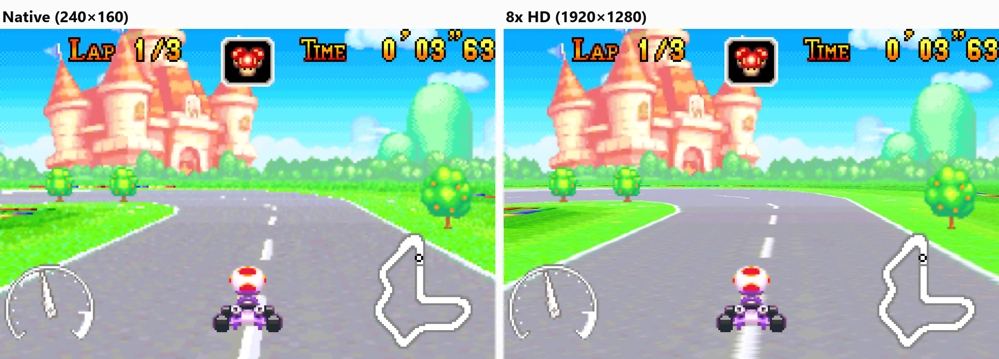

Game Boy Advance is experimental.

[gbarecomp](https://github.com/mstan/gbarecomp) translates GBA game code into C++ and links it against a runtime that models the handheld hardware.

The framework is general-purpose in direction. It can run games and support enhancements, but it still needs refinement before it is a broad first-choice path.

## What does it translate?

The GBA uses an ARM7TDMI CPU.

That CPU can run two instruction sets:

- **ARM**, with 32-bit instructions
- **Thumb**, with 16-bit instructions

The game can switch between them while it runs.

gbarecomp translates both modes and keeps track of which mode each function belongs to.

## What files does it need?

For a playable game project, you usually provide two legally obtained files:

- the GBA game dump
- a GBA BIOS file, if the project requires it

Some framework work may use generated or open alternatives where appropriate, but retail BIOS files are not provided here.

This site does not provide game files or copyrighted retail BIOS files.

## What makes GBA hard?

The hard part is **interworking**.

ARM and Thumb share the same address space. An address alone may not be enough to say what code is there. The project also needs to know which instruction set is active.

That matters for function discovery, jump tables, branches, interrupts, and any code that switches modes.

If the mode is wrong, the recompiler reads the bytes with the wrong instruction width.

## What else does the runtime handle?

The runtime models the rest of the GBA around the translated CPU code.

That includes graphics, audio, DMA, timers, interrupts, save hardware, cartridge behavior, and special devices used by some games.

Some GBA projects also explore adaptive widescreen and other enhancements. Those features should stay opt-in and should not change the faithful default view.

## How does it draw the screen, and how fast?

GBA graphics are the clearest example in the fleet of a faithful renderer being kept as the reference while faster host-native renderers do the everyday work. The idea is on [How does host-native HLE make a port faster?](/docs/concepts/host-native-hle).

**The LLE renderer.** The original renderer copies the GBA video chip one pixel at a time. For each pixel it finds the tile, applies flips, reads the palette, checks windows and priority, and blends. It is correct and easy to compare against hardware. It is also where a large share of the frame time went.

**The line compositor.** The default renderer now builds each line differently:

- it decodes tile spans of up to eight pixels at once, instead of repeating map and address work per pixel;
- it works out window rules once per line;
- it keeps colors in native RGB555 until the line is published.

It has the same entry point, the same schedule and no cache across lines. Across 128 deterministic frames covering video modes 0 to 5, tile formats, scrolling, windows, sprites, affine layers, bitmap pages and blending, its output was byte-identical to the LLE renderer. Separate gameplay runs of Mario Kart: Super Circuit and Mega Man Zero matched too. That proves the tested cases, not every game. Overall FPS rose about 7% and 6% in those two games. The choice is made when the game is built (`GBARECOMP_SCANLINE_IMPLEMENTATION`), and the LLE renderer stays in the source.

**Higher internal resolution.** Some games allow a finer image than the GBA could show. Mario Kart: Super Circuit is the first: its 3D-looking course layer is sampled at a higher resolution. Sprites and HUD art stay native. This is a presentation layer. The game's own video chip state stays native, and save states and netplay never see it.

At high scales the CPU was doing all of that sampling. The current path does the high-resolution sampling, composition and presentation on the GPU, fed by fixed per-line state from the CPU, and keeps the image on the GPU. CPU code that needs the image gets a copy only when it asks. A portable CPU renderer stays behind the same interface.

On Mario Kart: Super Circuit at 8x in widescreen, CPU time per frame fell from 72.6 ms to 11.8 ms. On a 2013 PC with a GTX 760, 8x went from under 25 FPS to over 150. Scales up to 4x are recommended. Higher scales are labeled experimental, because the work grows with the square of the scale.

**What did not win.** A further native renderer change measured 12.9% less CPU time on Mega Man Zero. But two runs of the unchanged build already differed by 3.4%, and the paired runs spread by 4.6 points, so the result was called inconclusive. It stays off by default. See [Optimize a port without losing accuracy](/docs/guides/optimize-a-port) for why that matters.

## What happens if discovery misses code?

A missed function should become a visible development problem, not hidden fake behavior.

The project can use fallback execution, logs, or a cache path to keep the game moving while pointing developers at the missing coverage.

As with the other frameworks, the goal is to improve the tool and the game configuration, not patch around missing behavior with stubs.

## What are the main limits?

- The framework is still earlier than PlayStation and SNES.
- Interworking makes discovery and dispatch more complex.
- A playable project may require a legally obtained BIOS.
- Enhancements need game-specific validation.
- High internal resolution is only enabled for games that approve it, and scales above 4x are experimental.
- Generated code is a starting point, not a finished port.
