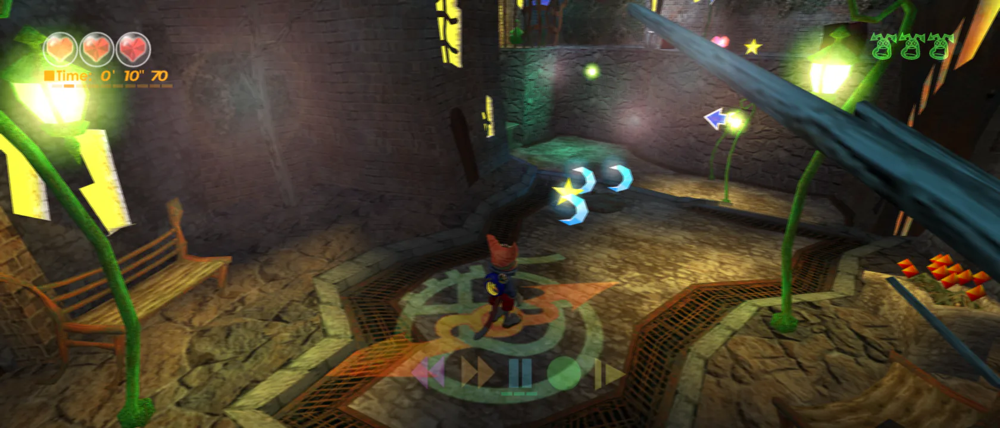

Original Xbox is an early beta.

[XboxLLR](https://github.com/mstan/xboxllr), the Xbox Low Level Recompiler, is a recompiler, a set of shared console services, a native title host, an Xbox-style launcher and tools for preparing each game. It was called xboxlle before, and some internal names still use that spelling.

It runs two public games and the original Dashboard. It does not run arbitrary Xbox games.

## What does it translate?

The Xbox uses an Intel Pentium III, an x86 CPU.

XboxLLR finds the game's x86 functions, translates them to C and compiles them ahead of time. Each game's metadata ties that work to one exact executable revision: its image, calling conventions, memory layouts and recovered jump targets.

There is no fallback interpreter. If the game reaches a target the build did not find, it stops with a diagnostic. That makes a gap visible instead of guessing at it.

## How do LLE and HLE fit together here?

XboxLLR keeps three ideas apart:

- **Native** describes how CPU code runs. The game's x86 code is already translated.
- **LLE** describes a faithful, low-level version of a console service, close to what the hardware and kernel did.
- **HLE** describes a faster native version of that same service.

The low-level path comes first. It sets the contract: what goes in, what comes out, what memory changes, what errors happen, and in what order. Then a host-native version can replace it, and one high-level part may replace several low-level parts at once. It only has to keep the same contract. What happens inside is free to change.

The project calls this **host native friendly HLE**: the replacement picks operations that are fast on a Windows or Linux PC instead of copying how the Xbox did the work.

The reference build and the fast build are chosen when the game is built. Normal play does not run both side by side. Hand-written answers that fake success are not allowed. The general idea is on [What are HLE and LLE?](/docs/concepts/hle-and-lle).

Many early Xbox recompilers were HLE only, built to get one game running. XboxLLR adapted HLE work from several of them, with permission, and made each piece follow this contract. See [Where does the HLE come from?](#where-does-the-hle-come-from) below.

## What else does the runtime handle?

Shared native services cover files, memory, scheduling, input, graphics and audio. Games and the Dashboard use the same services. Each one is set by a low-level device or original-code reference route, and keeps the behavior callers can see.

For graphics, the game's drawing is done natively through Direct3D 11 on Windows and Vulkan on Linux, at the internal resolution the player picks, then shown in the window.

Everything that ties native code to a game is bound to one exact executable revision. A different revision of the same game needs its own metadata.

## What files does it need?

You supply your own game files for the supported revision:

- the extracted `default.xbe` plus the complete asset folder, or
- an `.iso` or `.xiso` where the game supports it.

On first launch you can choose **Skip** to create a new virtual console with its own save folders. A new console does not need a kernel dump. You can also import files from a real console.

No firmware, executables, game media, keys or saves are included. Translated code is generated privately from your files.

## Which games run?

| Project | Status in its own words | Platforms |
|---|---|---|
| [Blinx: The Time Sweeper](https://github.com/mstan/BlinxRecomp) | Public beta. "Tested through World 2; end-to-end completion is not guaranteed." | Windows x64, Linux AppImage |
| [Jet Set Radio Future](https://github.com/mstan/JSRFRecomp) | "Early beta: not exhaustively playtested or tested end to end." | Windows x64, Linux AppImage |
| Xbox Dashboard 5960 | Beta native preview. Home, Memory, Music and Settings work in part. Xbox Live is offline. It cannot launch other games. | Windows x64 |

Linux builds target x86_64, an Ubuntu 24.04 baseline and Vulkan 1.3.

## What can Xbox ports add?

- Adaptive widescreen with **Fit to screen**, from 4:3 up to 32:9. The camera widens and HUD pieces anchor to the edges. Menus and movies can stay 4:3. See [Common tricks](/docs/tricks).
- Higher internal resolution, supersampling, FXAA and anisotropic filtering.
- Optional blended 60 or 120 Hz presentation. This blends frames for display. The game still simulates at its original rate, and blending can add a frame of latency and double edges.
- Game-specific mods, such as removing Blinx's ten-minute stage limit or importing your own graffiti into Jet Set Radio Future.

## How fast is it?

Host-native replacements cut Blinx's CPU time at 3x internal resolution from 57.0 to 34.4 ms per update. Game speed went from 23.8 to 29.5 updates per second, against a target of 30. That is one game on one PC. Each optimization is measured per game, and a gain in one game cannot cancel a loss in another.

The full set of measurements is in [Slowing down to speed up](/blog/slowing-down-to-speed-up). The method is in [Optimize a port without losing accuracy](/docs/guides/optimize-a-port).

## Where does the HLE come from?

XboxLLR borrowed and adapted HLE work, with permission, from:

- sp00nz's [xboxrecomp](https://github.com/sp00nznet/xboxrecomp)
- Phobos's [DirectXbox-Recomp](https://github.com/phobos665/DirectXbox-Recomp), whose Direct3D 11 renderer the Windows builds use
- NoRain's [doaxvb-re](https://github.com/NoRain211/doaxvb-re)
- the [xemu](https://github.com/xemu-project/xemu) team's reference implementations

It also credits [apexJCL](https://github.com/apexJCL/blinx1-recomp), whose Blinx work inspired its RAM-cache design.

xemu is a reference, not an independent check where code is shared. Real hardware is the authority.

## What are the main limits?

- It is an early beta. A new game will likely reach missing services that need work in the shared engine.
- The downloads do not run arbitrary games. Each game needs its own prepared title project.
- There is no fallback interpreter yet, so discovery gaps stop the game.
- Higher internal resolutions and supersampling are not fast on every machine.
- Online play is not available yet.

To start your own game, read the [XboxLLR README](https://github.com/mstan/xboxllr) and its build-tool guide. Send engine fixes upstream as pull requests.
