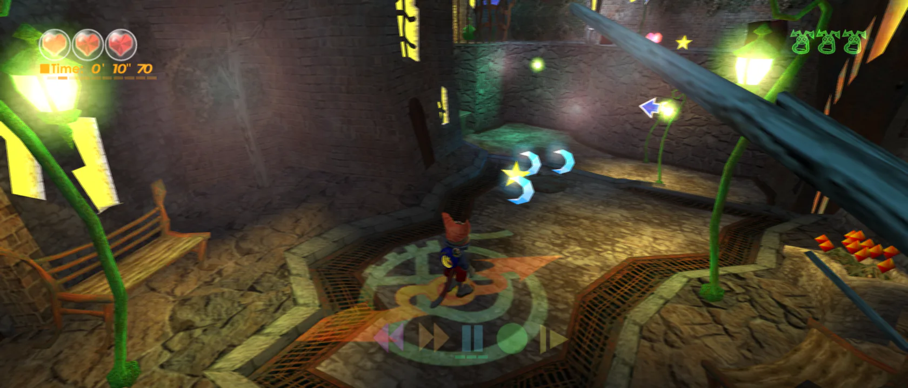
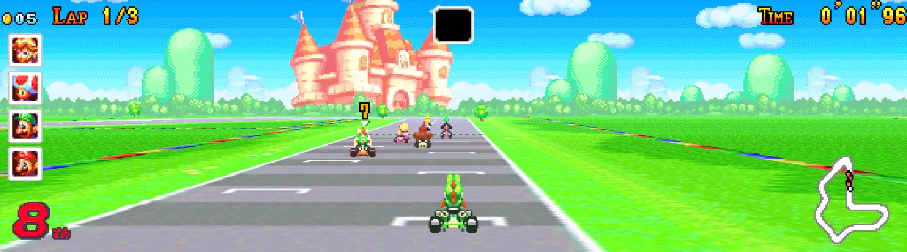
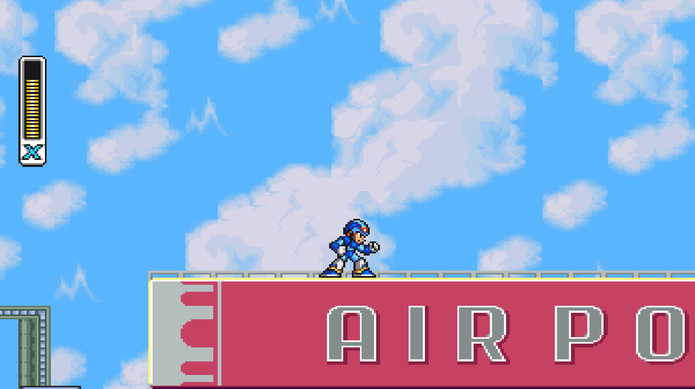

When the view gets wider, the HUD does not move by itself. It stays where it was on the 4:3 screen, so health bars float in the middle of a wide image with empty space around them. Or, if the whole image is stretched, the HUD stretches with it.

**HUD anchoring** fixes this. Each HUD piece is pinned to the edge it belongs to.

## How does it work?

1. **Find every HUD piece.** Identify each one by where the game draws it: the draw call, sprite, texture, background layer or text routine.
2. **Sort them into groups.** Left, center or right. A player's health is usually left. A boss gauge is usually right. Dialogue, prompts and pause menus are usually center.
3. **Move each group by the right amount.** Left pieces shift by the new left margin. Right pieces shift by the right margin. Center pieces do not move.
4. **Keep the shape.** Move a piece, do not stretch it. Its proportions should stay the same at every width.

Anchoring works at the point where the game hands the HUD to the screen. The game's own logic still thinks the HUD is in its original place.

## How do you keep the faithful path?

At 4:3, both margins are zero, so every offset is zero. The HUD lands exactly where it always did.

## What goes wrong?

| Problem | What to do |
|---|---|
| One group spans the whole old screen. | Split it. Blinx's bottom HUD strip was first treated as one centered group. Playtesting showed it needed separate left, center and right groups. |
| A HUD texture is wider than what it shows. | Anchor by the visible part, not the quad. One Blinx slot frame used a padded 256-pixel quad whose visible circles sat on the left. |
| Things that look like HUD are part of the world. | Markers, target circles and lock-ons that follow an enemy should move with the camera, not with an edge. Blinx tells these apart by how they are drawn. |
| A full-screen effect gets squeezed into 4:3. | Fades, tints and screen streaks should cover the whole wide frame. Exempt them from anchoring. |
| Menus split apart. | Leave full-screen menus centered. Check pause menus over gameplay separately. |

## Examples of where it's used

**[Blinx](https://github.com/mstan/BlinxRecomp) on XboxLLR.** Health, time and the crystal queue anchor left. Monster icons and trash inventory anchor right. Time controls, dialogue and pause UI stay centered. Menus and stage select stay 4:3, and the results screen widens its 3D replay while keeping its overlay centered. The 21:9 shot at the top of this page is Blinx.

**[Mario Kart: Super Circuit](https://github.com/mstan/MarioKartSuperCircuitRecomp) on gbarecomp.** Coins, lap, racer portraits and race position sit at the left edge. Time and the course map sit at the right.

**[Mega Man X](https://github.com/mstan/MegaManXSNESRecomp) on snesrecomp.** HUD edge anchoring is always on when its widescreen mod is enabled.

**[Mega Man X4](https://github.com/mstan/MegaManX4Recomp) on psxrecomp.** In the experimental 16:9 mode, player health and weapon pieces anchor to the wide left edge, enemy and boss health to the wide right edge.

Next: the HUD is placed, but the camera can still show empty space at a room's edge. See [Camera anchoring](/docs/tricks/camera-anchoring).
