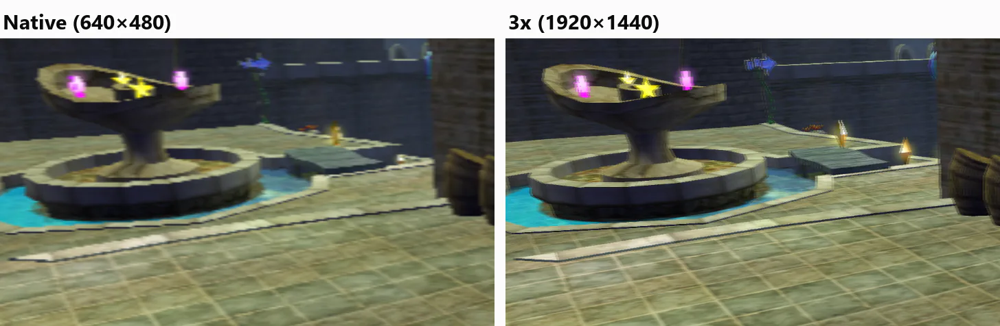
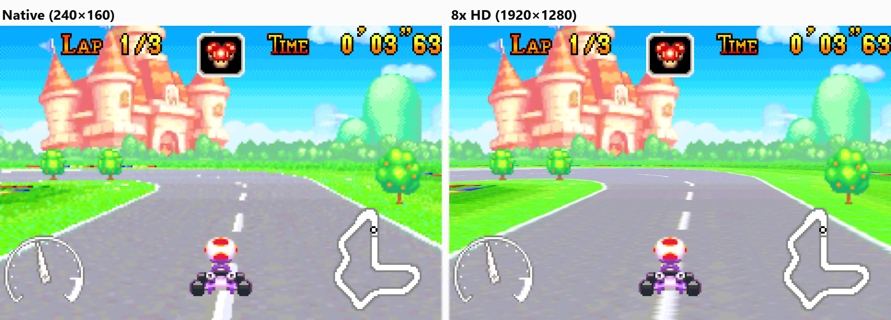
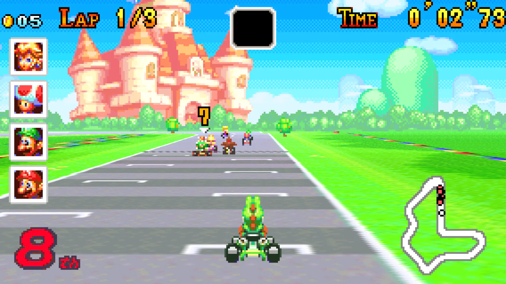

A port locked to the original game's speed does not run faster when its code gets faster. It finishes each frame sooner and waits. That spare time is **headroom**.

Headroom can be spent on things players see: higher internal resolution, supersampling, wider views, or running on weaker hardware.

## How does it work?

1. **Make the faithful path cheaper.** Replace expensive groups of LLE parts with host-native HLE. See [How does host-native HLE make a port faster?](/docs/concepts/host-native-hle).
2. **Measure in milliseconds per frame.** FPS stays at the cap until you run out of headroom, so it hides the gain.
3. **Add a presentation layer.** Render a finer or wider image from the same game state.
4. **Let the player choose.** Offer scales and quality options, and say which ones are expensive.

## How do you keep the faithful path?

Keep the high-resolution image out of the simulation.

In gbarecomp, the game's own video chip state stays native. The enhanced image, its buffers and its history are left out of save states and netplay snapshots. In XboxLLR, Blinx keeps its original guest resource metadata while the renderer draws at a higher internal resolution.

At 1x, the result should match the original renderer.

## What goes wrong?

| Problem | What to do |
|---|---|
| Higher scales get slow fast. | Work grows with the square of the scale: 8x has four times the pixels of 4x. Recommend a safe default and label the rest. gbarecomp marks every scale above 4x experimental. |
| The upscale shows no extra detail. | Only some layers have more detail to give, such as 3D or affine backgrounds. Sprites and pixel art stay the same. Check before you ship a scale nobody benefits from. |
| One setting is too slow on some machines. | Ship a safe default and document a cheaper fallback, such as original resolution without supersampling. |
| The image is too big for the GPU. | Reduce only the upload when a texture limit or allocation fails. Keep the logical view and game state unchanged. |

## Examples of where it's used

**Blinx on XboxLLR.** At 3x internal resolution, CPU time per update fell from 57.0 to 34.4 ms. Game speed went from 23.8 to 29.5 updates per second, against a target of 30. The comparison at the top of this page is Blinx.

**Mario Kart: Super Circuit on gbarecomp.** Its course layer can be sampled at higher internal resolutions while sprites and HUD stay native. Moving that work to the GPU took 8x widescreen from 72.6 to 11.8 ms of CPU per frame, and from under 25 FPS to over 150 on a 2013 PC with a GTX 760. See [Game Boy Advance](/docs/platforms/game-boy-advance).

**PlayStation ports** such as Ape Escape at 4K and Mega Man X6 at 4x. See the results table in [How does host-native HLE make a port faster?](/docs/concepts/host-native-hle#what-were-the-results).
