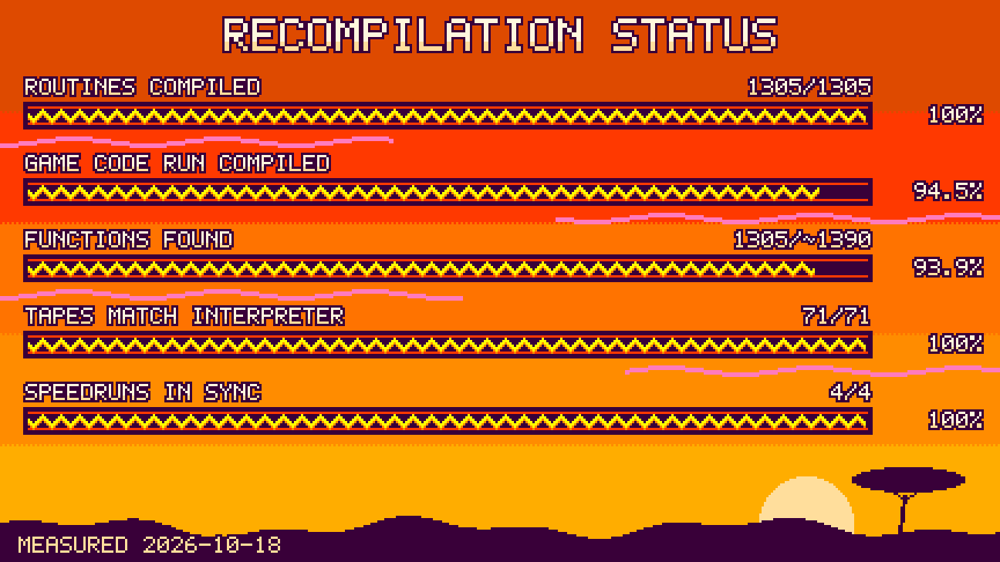
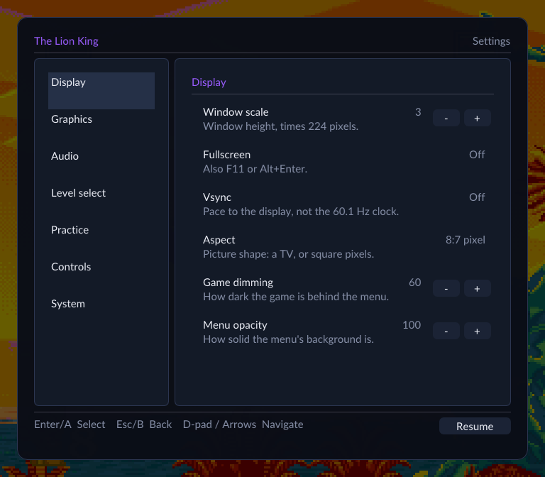
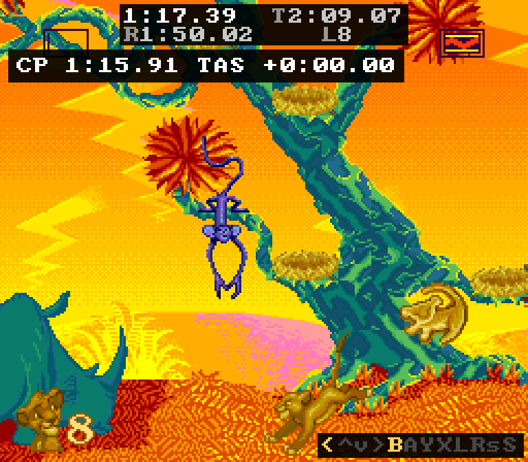

TLKRecomp is a static recompilation of The Lion King \(SNES\), built with [SNESRecomp](/hardware/super-nintendo)

## Project

Disney's The Lion King \(SNES, 1994\), running as a native PC program.

TLKRecomp is a static recompilation of the US release, built with [SNESRecomp](/hardware/super-nintendo). The game's 65816 program is translated to C and compiled for your CPU; graphics, sound and timing run on [SNESRecomp](/hardware/super-nintendo)'s emulated PPU and SPC, so it plays like the cartridge, from the Westwood logo to the last hit on Scar. It runs on Linux, Windows and macOS \(Apple Silicon\).

No game data is in this repository. No ROM, no assets, no generated code. Bring your own dump \(Lion King, The \(USA\).sfc, 3 MiB headerless, SHA-256 457abe63...0f3712\); the build reads it and generates the C on your machine, and the release builds need it to start.

- Routines compiled: every entry point the recompiler knows about has a compiled C body.
- Game code run compiled: share of the instructions on a whole-game run \(All Bugs, idle loops excluded\) that run as compiled C. The rest still runs in [SNESRecomp](/hardware/super-nintendo)'s interpreter: a few routines the game enters in a CPU mode the compiler can't handle yet.
- Functions found: entry points known to the recompiler, out of about 1,390 known to exist. The real total is probably 1,450-1,550; the rest are reached only through pointers \(docs/functioncount.md\).
- Tapes match interpreter: 71 hand-made input tapes give the same frame and RAM compiled and interpreted.
- Speedruns in sync: three TASVideos runs and All Bugs, game RAM checked against BizHawk \(bsnes\).

The card is drawn by tools/statuscard.py, in the colours of the game's HUD; each number in it names the command that measured it.

- The whole game, start to finish, bonus stages included, on keyboard or gamepad.
