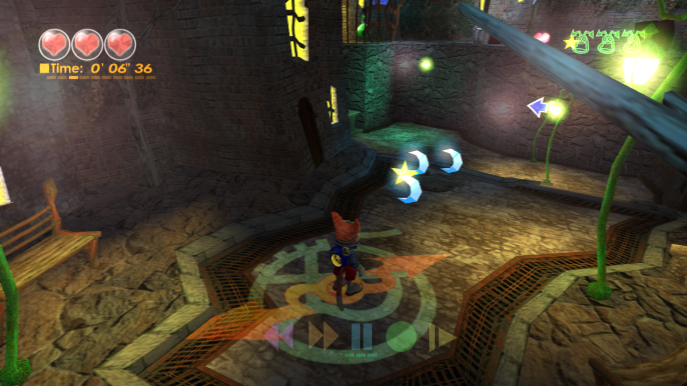
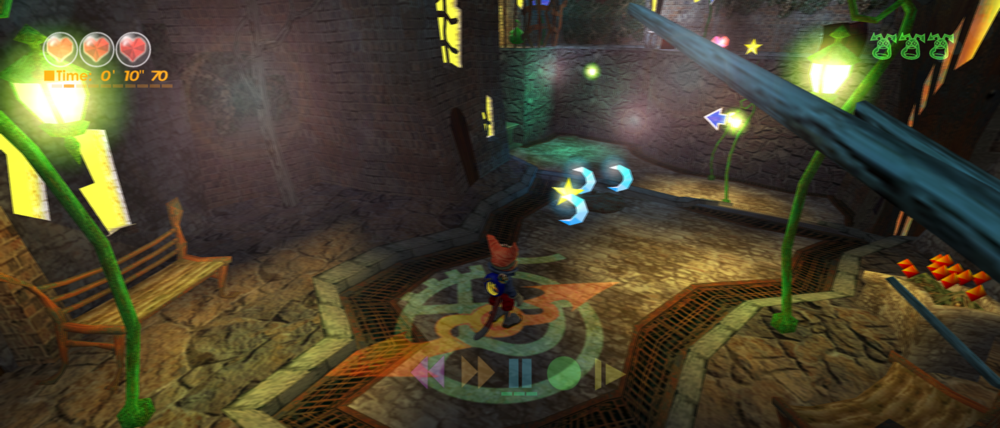

A recompilation of Blinx the Timesweeper using Xbox Low Level Recompiler \(xboxllr\)

## Project

Play Blinx on Windows with adaptive widescreen, higher internal resolution, controller support and optional gameplay mods through an Xbox-themed launcher. Built on XboxLLR, the early low-level Xbox recompiler ecosystem.

Download the playable Windows x64 alpha — no compiler needed. Supply your own supported NTSC-U game files.

Fresh launchers default to adaptive Fit to screen, 1080p internal rendering, 2×2 supersampling, FXAA, 8× filtering and blended 60 FPS presentation. Change these individually under Mods. See graphics options and costs.
