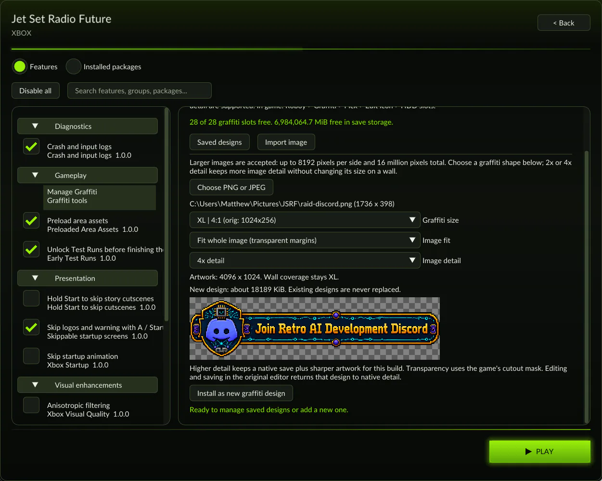

Jet Set Radio Future runs on [XboxLLR](/hardware/xbox), the same engine as [Blinx](/games/blinxrecomp-7f8296d8).

It is an early beta. It has not been tested end to end, so save often and report crashes with the diagnostic ZIP the game offers.

## Can I play it?

Yes. Download the [Windows ZIP or Linux AppImage](https://github.com/mstan/JSRFRecomp/releases/latest). No compiler is needed.

You need your own supported NTSC-U game files: an `.iso`, an `.xiso`, or the extracted `default.xbe` with its game assets. The USA standalone release and NTSC-U certificate revision 4 are supported.

## What does it add?

- Fit to screen widescreen, on by default, including ultrawide windows.
- Internal resolution options, 1x to 8x supersampling, FXAA and texture filtering.
- **Early Test Runs.** Collect an area's graffiti souls to unlock its challenges before you finish the story.
- **Your own graffiti.** Import PNG, JPEG or TGA artwork, then pick it in game like any other design.
- Optional startup and cutscene skipping, and blended 60 or 120 Hz presentation. Gameplay keeps its original timing.

## Where do I report bugs?

Open an issue on [JSRFRecomp](https://github.com/mstan/JSRFRecomp/issues) with the release, the area, your selected mods and the steps to reproduce. Never upload game files.
