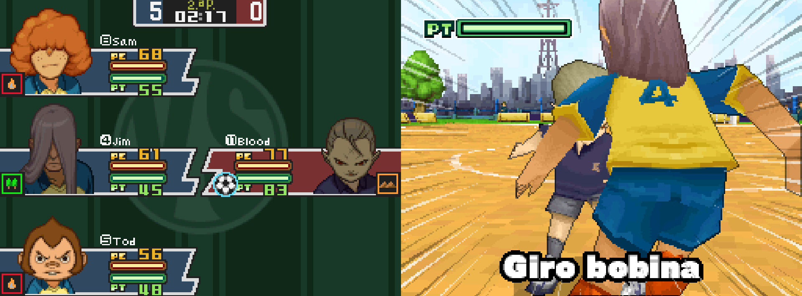
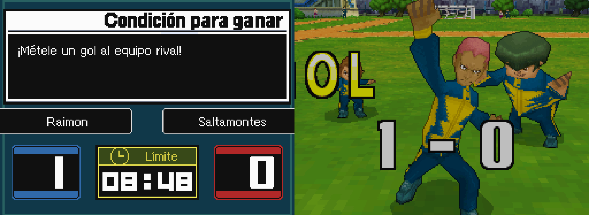
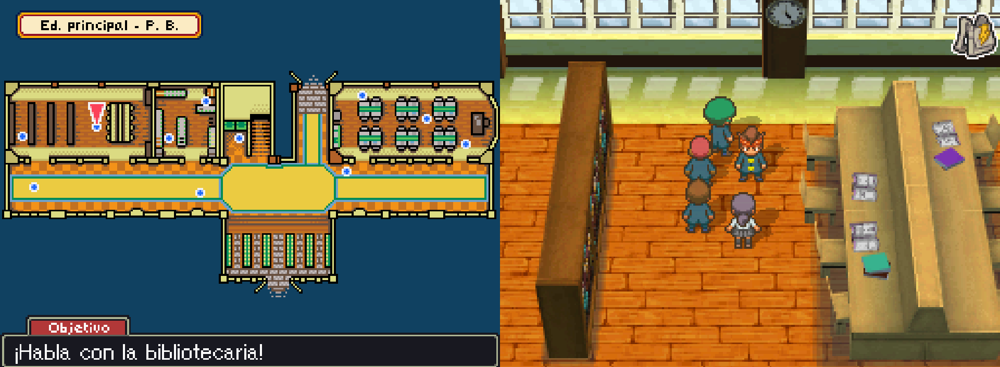

Native PC port of Inazuma Eleven \(Nintendo DS, Europe\) built with [NDSRecomp](/hardware/nintendo-ds) static recompilation. Full game at 60 FPS with a launcher and in-game menu in English and Spanish, window/fullscreen and scaling options, remappable keys and gamepad support, Spanish text and voices from your own Spanish ROM, mods \(free training, IE2-style special move levels, Japanese voices\) and experimental local wireless play between two PCs. Alpha. Bring your own ROM; no game data is included.

## Project

The game's code was translated to native PC code ahead of time, so it runs at full speed without an emulator. You provide your own legally obtained ROM. No Nintendo ROM, BIOS, firmware, save data, or generated ROM-derived source is distributed in this repository.

- Full game through the [NDSRecomp](/hardware/nintendo-ds) runner, at 60 FPS \(performance mode\).
- Launcher: play, mods \(with info sheets\), options \(language, voices, window, size, layout, scaling, VSync, controls\) and network play.
- In-game Esc menu in English or Spanish \(display, language, keys, save states, mods, restart\).
- Local wireless play between two PCs \(same network, or over the internet with a virtual LAN such as Radmin VPN or ZeroTier\).
- Language packs built from your own ROMs \(Spanish text, voices and in-code text; Japanese voices\).
