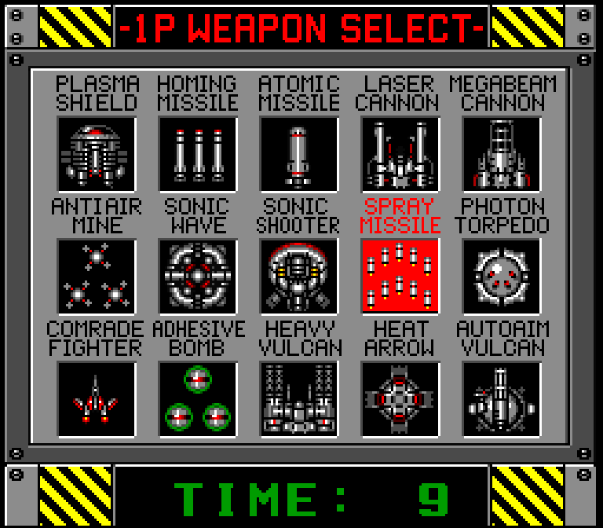
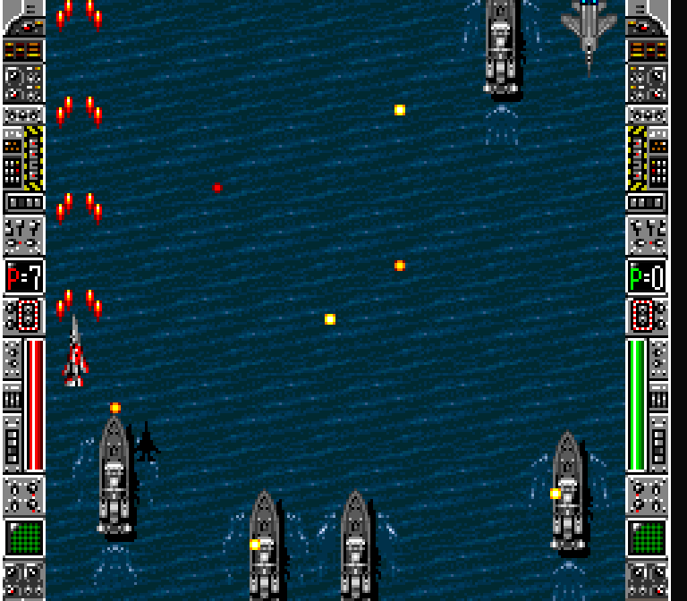

Native recompilation project of an under the radar SNES title, Strike Gunner S.T.G\! It's a classic shoot 'em up \(shmup\) where you can choose unique weapons before the start of each stage. It's a real gem, in my opinion\! The game should be fully playable from start to finish, I played through myself, but I have not had a chance to fully play with 2 players, and I have not tested the higher/lower difficulties.

## Project

A native recompilation of Strike Gunner S.T.G \(USA\), built on [SNESRecomp](/hardware/super-nintendo).

A vertical shoot-'em-up from 1992, recompiled from the 65816 to native code: the game's own logic runs as compiled C against an emulated SNES video chip, sound chip and DMA, with the framework's interpreter as a fallback for code no analysis has reached.

Just want to play? Download the latest release from the Releases page and see PLAYING.md: setup, controls, options and how to report a problem. The rest of this file is for building and developing the port.

Playable from start to finish \(as of 2026-10-14\): intro, attract demo, all stages, and the ending through the credits to "The End", in single-player play on Windows. Two-player play starts and both ships answer their own controller \(headless check\), and the launcher's second seat works with either player on keyboard or pad; a full 2P playthrough has not been done.

- Accuracy. Checked against snes9x with identical scripted input: game events land on the same frames for the first 3,162 frames of a 13,500-frame route, in both compiled and interpreted execution, and stage 4's heaviest section slows down exactly as much as on the reference \(3,536 of 3,600 frames on time\).
- Graphics. Correct throughout play, including save states loaded while paused.
- Audio. Matches the reference. The remaining occasional pops are in the game's own sound \(see Options\).
- Native code. 982 compiled variants, seeded from coverage captures of the intro, attract demo, stage 1, one full playthrough and the ending \(recomp/coverage/\). Uncovered code runs on the interpreter.
